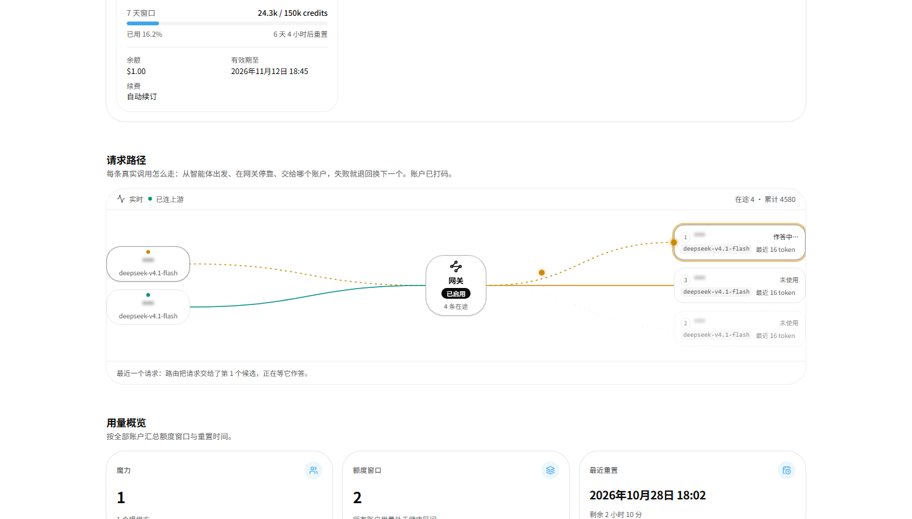

# 请求路径图（首页“请求路径”一节）

首页账号列表下方那块图：左侧是发起请求的智能体，中间是网关，右侧是候选位置（provider /
key / 账号）。每个点都是一次真实调用——光点从智能体飞到网关、再落到候选旁边等它作答；失败就
退回网关、再飞向下一候选；成功后答案沿原路飞回智能体。

只有图，没有请求列表。**账户与客户端名字都打码**：服务端把候选 provider 换成不透明的
`k1`/`k2`…、展示名统一成 `***`、模型 id 去掉 `provider/` 前缀，客户端再叠一层
`blur(2.5px)`；所以浏览器拿到的 DOM 和 JSON 里都没有原始账号/供应商名字。



---

## 1. 需要哪个 API

**只要一个：`GET /api/gateway/trace?after=<seq>`** —— 整条路径动画的数据都在这里（在途/
已结束请求、候选顺序 `order[]`、每次尝试 `tries[]` 的 start/done/status/ms/ttft）。

| 需求 | 接口 | 是否必需 |
| --- | --- | --- |
| 在途 / 已结束请求、候选顺序、每次尝试的时间与结果 | `GET /api/gateway/trace?after=<seq>` | **必需，唯一** |
| 回看某天 | `GET /api/gateway/history?day=YYYY-MM-DD` | 可选 |
| 按 id 取单条 | `GET /api/gateway/route?id=&day=` | 可选 |
| 候选图标 / 网关是否在服务 | `GET /api/providers` | 可选（trace 自带 `mine`） |
| 智能体显示名 | `GET /api/state` | 可选（trace 只给 `agent` id） |

返回形状与语义（upsert 流、`seq` 游标、`order: null` 的归一化、在途字段缺失）见
[docs/magpie-api.md](magpie-api.md)，上游动画的逐行拆解见
[docs/magpie-routing-animation.md](magpie-routing-animation.md)。

### 认证：必须由服务端去取

```
GET <web>/?k=<key>          → 303 + Set-Cookie: <name 带端口>=<key>（HttpOnly, SameSite=Lax）
GET <web>/api/gateway/trace?after=0  （带上该 cookie）→ 200 JSON
```

cookie 是 HttpOnly、`/api` 完全没有 CORS 头、首页还常跑在 new-api 的 sandbox iframe
（opaque origin）里——浏览器直连不可能成功。所以 `src/server/routing.server.ts` 登录 +
轮询，浏览器只跟本项目 server function 说话。登录 cookie 按 base 缓存 30 分钟，401 自动重登
一次。

## 2. 配置

```dotenv
# 最省事：把 web 启动时打印的整条链接（带 ?k=）粘进去
GATEWAY_WEB_URL=http://127.0.0.1:3430/?k=<web 的访问 key>
GATEWAY_WEB_KEY=
GATEWAY_WEB_TIMEOUT_MS=5000
```

两种写法都认：链接里带 `?k=`（key 从链接读），或者 `GATEWAY_WEB_URL` 只写地址 +
`GATEWAY_WEB_KEY` 单独给 key（两个都写时以 `GATEWAY_WEB_KEY` 为准）。没写协议时按 http
补上。

### key 不对时怎么判断

- 打开链接只看到 401 且正文 428 字节 → 没带 cookie，正常；
- 带上 `?k=` 仍是 401、正文 82 字节（`this link's key is not this magpie web's`）→ 这台 web
  能连上，但 key 不是它的；
- **`sk-…` 这种是网关的 API key（`/v1` 用的），不是 web 的访问 key**。web 的 key 在它启动
  时打印的链接里；部署时通常用 `MAGPIE_WEB_KEY` 固定它，否则每次重启都会换新的随机 key。
  拿不到就重启一次 web，从启动日志里复制新的链接。

## 3. 数据怎么到这块图

```
首页 loader（SSR，最多等 800ms）        浏览器挂载后
  ensureRoutingSeed()                   useRoutingStream()
        │                                     │
        └──► React Query 缓存（种子）──────────► Map<id, route> ──► deriveRoutingView()
                                                                        │
                                              geometry.layoutStage() ───┴──► timeline.frameForTrip()
                                                                                  │
                                                                           每帧 rAF 定位光点
```

- `src/server/routing.server.ts`：登录、取 trace、zod 校验、single-flight、失败不抛错
  （原因写进 `source.warning`），并在**离开服务端之前**把候选的 `name`/`provider` 抹成
  `***`。
- `src/lib/routing/queries.ts`：查询键 + `ensureRoutingSeed`（给 SSR 一个 800ms 的预算，
  连不上远端时不拖慢首页，浏览器挂载后自己补）。
- `src/features/routing/use-routing-stream.ts`：以种子的 `seq` 为起点循环取增量（1.5s 一轮），
  按 id 合并，用 `snapshot.now` 校正时钟偏移，后台标签页暂停。
- `src/lib/routing/derive.ts`：最近 10 条请求（在途永不淘汰）、≤4 个智能体、≤10 个候选，
  **与时间无关**，所以 SSR 与 hydration 一致。
- `src/lib/routing/geometry.ts` / `timeline.ts`：布局与时间轴，纯函数，45 个单测。

## 4. 状态与文案（对齐上游页面）

- 网关节点：读到了上游就显示“已启用”，否则“待命”；下面一行是在途条数。
- 每张候选卡片按路由对它的处置显示状态：**回答了这个请求 · 3.8 秒**（绿）、**作答中…**（停靠中）、
  **503 · 超时**（红）、**未使用**（在候选里但这次没轮到）；有 \`used\` 时补一行“最近 N token”。
- 卡片下方一行“最近一个请求…”说明这次路由做了什么：第几个候选、失败后退回网关再转给谁、最后由谁回答。
- **状态只讲最新那一条请求**（在途的，或刚结束的），不会把几条请求的状态混在一张图上。
- 卡片左侧的小数字是**顺位**：最新请求的 `order[]` 里它排第几。列按稳定顺序排列（上游也是“列
  不动、用到的那个自己亮”），所以正在作答的那张不一定在最下面，看数字即可对齐顺序。

## 5. 排障记录：状态曾经“串位” / “线一直亮着”

早期实现有几个坑。前三个的症状是“上游明明在用最后那个账号，图上却标在别的卡片上，同时还显示
另一个‘回答了这个请求’”：

1. 不透明编号按**每份响应**重新发（k1、k2…），而客户端是跨轮询按 id 合并的：同一个真实候选在
   两次响应里拿到不同编号，落点就会串位。现在编号表是**进程级**的（p1、p2…，同一进程内恒定）。
2. 卡片状态取的是“所有近期请求里最后一次尝试”，于是一条旧请求的“回答了这个请求”会和在途请求
   的“作答中…”并排出现。现在只看**最新那一条请求**。
3. 列是按稳定顺序（provider / model / 编号）排的，不随每条请求的优先级跳动——用卡片上的顺位数字
   对齐上游的顺序。
4. 第四个坑的症状是“网关显示没有在途，图里的线却还亮着、光点停在账号旁边”：舞台只放 4 个智能体，
   而挑这 4 个时看的是“每个智能体最新一条请求的开始时刻”。于是一条跑得很久的在途请求会被四个
   刚发了快请求的智能体挤出舞台——`在途` 变成 0，它的光点却还停在账号上。现在：
   - **最新一条请求、以及有在途请求的智能体优先留下**（`src/lib/routing/derive.ts`）：前者保证卡片
     状态和底部说明仍讲“最近一个请求”，后者保证在途请求不会被快请求挤掉；
   - 确实被挤掉（或上游不再返回）的请求，在离开数据窗口时由 `src/features/routing/ghosts.ts`
     **收尾**：还在途的尝试按“已结束”记账，光点飞完返程就消失，连线交还给静态状态；
   - 幽灵（离开窗口但动画没播完的请求）最多留 4 秒，且只按**智能体稳定键**找线——不按旧视图里
     的列位置，免得点到别人的线上。

## 6. 视觉与动效

| 元素 | 规则 |
| --- | --- |
| 连线 | `live`（在飞，虚线 3/5 + 700ms 流动）、`lit`（走过的路，实线）、`rest`（没用到的候选，淡虚线） |
| 去程光点 | 半径 4.5，智能体主色（同一智能体恒定同色，永不用红色） |
| 回程光点 | 描边环，成功=智能体色，失败=红色描边 |
| 停靠 | 光点停在候选卡片左缘外，脉冲 1.2s，卡片泛**主色半透明光圈** |
| 账户 | `***` + `blur(2.5px)`，服务端已抹掉原始名字 |
| 降级 | `prefers-reduced-motion` 时不逐帧，静止画出路径与光点 |

样式在 `src/styles/app.css` 的 `@layer utilities`（`.route-wire` / `.route-pkt`），并登记在
文件末尾的 reduced-motion 白名单里。

## 7. 验证

```bash
bun run typecheck && bun run test && bun run build && bun run verify
```

## 8. 已知限制

- 只有 1 个 provider 时路径是直线；多候选的形状由单测覆盖。
- 舞台只画最近 10 条；更早的请走上游 history 接口（未接）。
- 舞台最多 4 个智能体。超过 4 个智能体同时在途时，被挤掉的那条请求会在离开数据窗口时按“已结束”
  收尾（见 §5 第 4 点），页面上的在途计数只算还留在舞台上的请求。
- 用普通轮询（`after=seq`，1.2s 一轮）；远端部署若想更跟手可改长轮询
  （[docs/magpie-api.md](magpie-api.md) §7.4）。
- 首页 SSR 给这块图 800ms 预算：远端慢时首屏先出骨架，挂载后补数据。